  

  &nbsp;
  

### `$ whoami`

Hi, I'm **Kaio** 👋 — I work in **operations at [Hostinger](https://www.hostinger.com)**, which keeps me close to the infrastructure that runs the web every day.

I'm building my way into **cybersecurity**: in **2027** I start a **Bachelor's in Computer Science at FAM**, and until then I'm studying on my own. I also have a creative side — I care about design and about how things look and feel, not only how they work.

### `$ cat now-learning.md`

- 🎓 **Harvard CS50** — CS50x, Python, SQL, Web and AI
- 🧭 **OSSU** — open-source, self-paced Computer Science curriculum
- ☁️ **Google Cloud Skills Boost**
- 🌐 **Origamid** & **curso.dev** — web development

### `$ ls ~/toolbox`

<picture>
  <source media="(prefers-color-scheme: dark)" srcset="https://skillicons.dev/icons?i=python,c,sqlite,html,css,js,linux,bash,git,github,vscode,gcp,figma&theme=dark">
  
</picture>

### `$ cat mission.log`

- [x] Operations at Hostinger
- [x] Self-studying Computer Science (CS50 · OSSU)
- [ ] 2027 — Start Computer Science at FAM
- [ ] Ship and document my first projects here
- [ ] Specialize in cybersecurity 🔐

 

  

